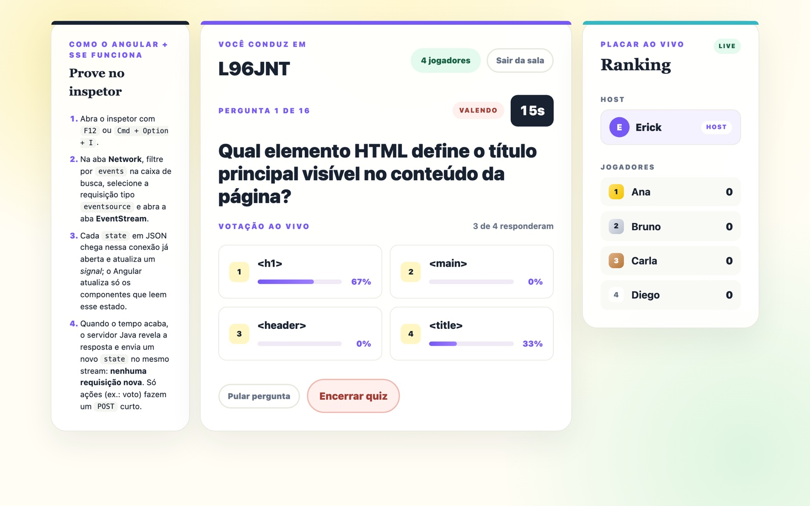
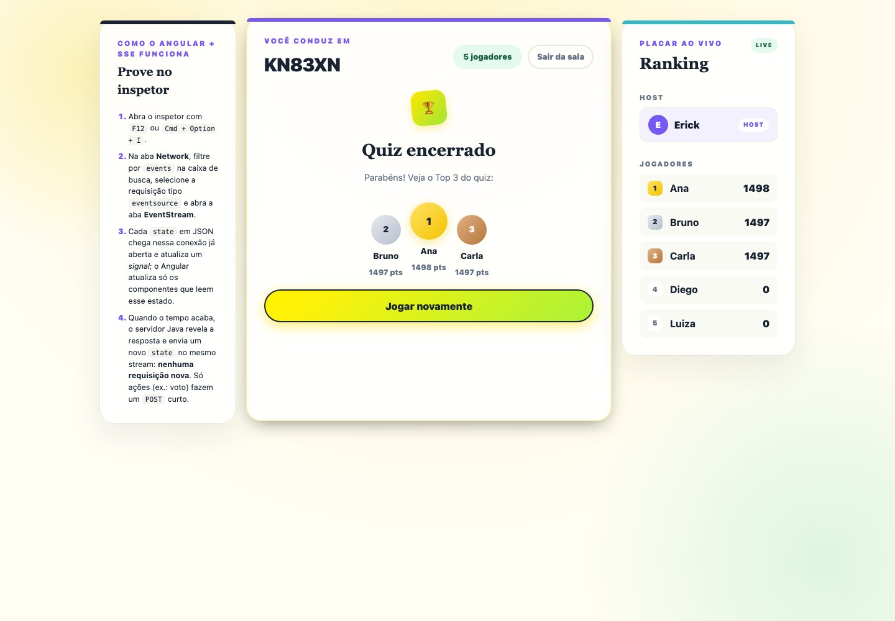
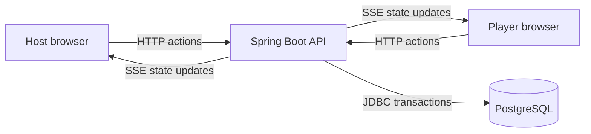

# Fresh Quiz — Angular + Spring Boot

A real-time multiplayer quiz about web fundamentals: create a room, share its
code, and compete with friends through timed questions and a live leaderboard.

**Status:** Playable learning project · Angular/Spring Boot rewrite of
[freshQuiz](https://github.com/ErickHTF/freshQuiz).

[](https://github.com/ErickHTF/angular-spring-quiz/actions/workflows/ci.yml)
  

[Run locally](#run-locally) · [Development guide](docs/development.md) ·
[Architecture](docs/architecture.md) · [API reference](docs/api.md)


| Live voting — host view                                                                    | Final podium and ranking                                                   |
| ------------------------------------------------------------------------------------------ | -------------------------------------------------------------------------- |
|  |  |

_The game interface is in Brazilian Portuguese._

## Overview

Fresh Quiz brings a host and players together in a browser-based game. The
included quiz covers HTML, CSS, HTTP, JavaScript and APIs across 16 questions.

- Join a room by code and nickname, with separate host and player views.
- Answer timed questions with individually shuffled choices.
- Follow live voting and automatic answer reveals through server-sent events.
- Earn points for correct answers, with a bonus for speed.
- Replay with the same group, resetting answers and scores.

## Stack

| Layer        | Technologies                                       |
| ------------ | -------------------------------------------------- |
| Frontend     | Angular 22, TypeScript, Angular signals            |
| Backend      | Java 21, Spring Boot 4, Spring JDBC                |
| Database     | PostgreSQL, Flyway migrations                      |
| Real time    | Server-sent events (SSE), HttpOnly session cookies |
| Verification | JUnit, MockMvc, Testcontainers, Vitest, k6         |

## Run locally

Install **Java 21**, **Docker**, and **Node.js with npm**. Supported Node versions
are `^22.22.3`, `^24.15.0`, or `>=26`. Maven is included through the wrapper.

Clone the repository:

```bash
git clone https://github.com/ErickHTF/angular-spring-quiz.git
cd angular-spring-quiz
```

Run each command in a separate terminal, starting from the repository root:

```bash
# Terminal 1 — database on port 5433
docker compose up -d
```

```bash
# Terminal 2 — backend on port 8080
cd backend
./mvnw spring-boot:run
```

```bash
# Terminal 3 — frontend on port 4200
cd frontend
npm ci
npm start
```

Open [localhost:4200/host](http://localhost:4200/host) to create a room. In another
browser session, open [localhost:4200](http://localhost:4200/) to join
using the room code. Flyway creates the schema and loads the quiz on startup.

The original Fresh Quiz also uses database port `5433`; stop its database before
starting this version. See the [development guide](docs/development.md) for
configuration and a disposable database alternative.

## Verification

With Docker running, execute these commands from the repository root in
separate terminals:

```bash
# Backend unit and integration tests
cd backend
./mvnw verify
```

```bash
# Frontend tests and production build
cd frontend
npm ci
npm test -- --watch=false
npm run build
```

The backend suite covers scoring, the game lifecycle, deadlines, authorization,
cookies and errors. Frontend tests cover shuffling, votes and the SSE store.
See the [load-testing guide](loadtest/README.md) for k6 scenarios.

## Architecture



Angular signals hold the state received through SSE. Spring computes the state
for each viewer, applies game rules, and persists changes in PostgreSQL.
Events are published after transaction commit so clients receive committed state.

SSE connections and reveal timers live in memory. The current design supports
one backend instance; after a restart, timers are rescheduled on the next room
state read. The original project's EC2 deployment was not ported.

Read the [architecture guide](docs/architecture.md) for the source layout, SSE
flow, game rules and implementation differences from the original.

## Documentation

| Guide                                | Contents                                                   |
| ------------------------------------ | ---------------------------------------------------------- |
| [Development](docs/development.md)   | Requirements, local setup, configuration and test commands |
| [Architecture](docs/architecture.md) | Porting decisions, source layout, SSE and game lifecycle   |
| [API reference](docs/api.md)         | Routes, sessions, request fields and error responses       |
| [Load testing](loadtest/README.md)   | k6 scenarios and execution instructions                    |

## Project context

This repository explores the same game with Angular and Spring Boot while
preserving the original Fresh/Preact version's rules, PostgreSQL schema and SSE
approach. The [original implementation](https://github.com/ErickHTF/freshQuiz)
provides a comparison of the two stacks.

No license is currently included in this repository.
