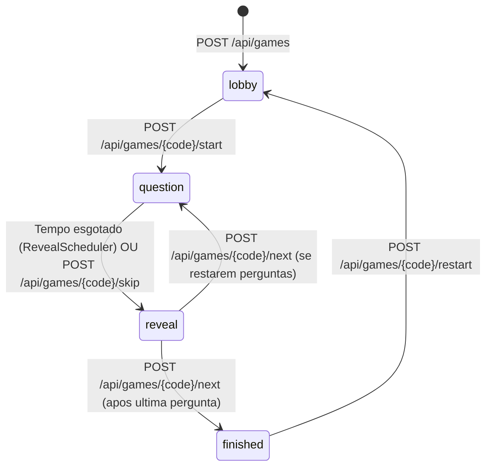

# Documentacao da API - Fresh Quiz

A API do **Fresh Quiz** e desenvolvida em Java 21 e Spring Boot 4, utilizando PostgreSQL 17 gerenciado pelo Flyway. A comunicacao em tempo real entre anfitriao (Host) e participantes (Players) utiliza **Server-Sent Events (SSE)** associada a requisicoes REST com cookies de sessao `HttpOnly`.

---

## 1. Visao Geral dos Endpoints

| Metodo | Rota | Papel | Descricao |
| :--- | :--- | :--- | :--- |
| `POST` | `/api/games` | Publico / Host | Cria uma sala com apelido do host; define o cookie de host. |
| `POST` | `/api/games/{code}/join` | Publico / Player | Entra na sala com apelido; define o cookie de player. |
| `GET` | `/api/games/{code}/me` | Autenticado | Identifica o papel (`HOST` ou `PLAYER`) e dados do usuario na sala. |
| `GET` | `/api/games/{code}/state` | Autenticado | Retorna o estado atual da sala filtrado pela visao do usuario. |
| `GET` | `/api/games/{code}/events` | Autenticado | Stream SSE contendo eventos `state` em tempo real. |
| `POST` | `/api/games/{code}/start` | Host | Inicia a primeira pergunta da partida. |
| `POST` | `/api/games/{code}/skip` | Host | Pula a pergunta corrente, disparando revelacao imediata. |
| `POST` | `/api/games/{code}/next` | Host | Avanca da revelacao para a proxima pergunta ou tela final. |
| `POST` | `/api/games/{code}/restart` | Host | Reinicia a partida para o mesmo grupo (zera placar e volta ao lobby). |
| `POST` | `/api/games/{code}/finish` | Host | Encerra a partida e define status como `finished`. |
| `POST` | `/api/games/{code}/answer` | Player | Submete a resposta da questao `{ choiceId }`. |
| `POST` | `/api/games/{code}/leave` | Player / Host | Limpa os cookies da sessao da sala. |

---

## 2. Seguranca e Cookies de Sessao

A API utiliza cookies `HttpOnly` com escopo restrito para isolar as permissoes sem expor credenciais ao JavaScript do navegador:

- **Host:** Cookie `fresh_host_<CODE>` gerado no momento da criacao da sala via [`SessionCookies.hostName(code)`](file:///C:/Users/mario/OneDrive/%C3%81rea%20de%20Trabalho/agente-gemini/angular-spring-quiz/backend/src/main/java/com/freshquiz/web/SessionCookies.java).
- **Player:** Cookie `fresh_player_<CODE>` gerado no momento da entrada na sala via [`SessionCookies.playerName(code)`](file:///C:/Users/mario/OneDrive/%C3%81rea%20de%20Trabalho/agente-gemini/angular-spring-quiz/backend/src/main/java/com/freshquiz/web/SessionCookies.java).
- O endpoint `/api/games/{code}/me` e utilizado pelo Angular para identificar se a tela atual atua como Host ou Jogador.

---

## 3. Estados da Partida (`status`)



---

## 4. Endpoints Futuros para o Caso "Gerenciar Quizzes e Perguntas"

Para suportar a nova dinâmica de criacao e edicao de perguntas customizadas pelo Host, a API sera expandida com os seguintes contratos:

```
POST   /api/quizzes                  -> Cria um novo quiz com titulo customizado
GET    /api/quizzes                  -> Lista os quizzes disponiveis para selecao pelo Host
GET    /api/quizzes/{id}             -> Detalha um quiz e suas questoes ordenadas
POST   /api/quizzes/{id}/questions   -> Adiciona uma questao com prompt, duration e escolhas
PUT    /api/questions/{id}           -> Atualiza enunciado, duracao ou alternativas
DELETE /api/questions/{id}           -> Remove a questao e reordena as posicoes subsequentes
```
