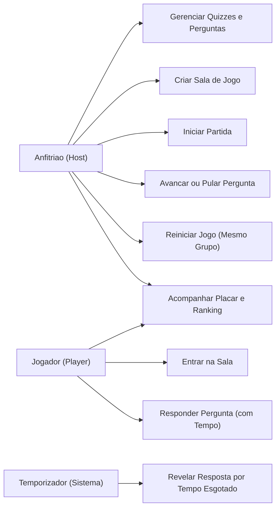

# Modelagem de Analise e Design - Fresh Quiz

Este diretorio reune os artefatos formais de modelagem UML e de dados do sistema **Fresh Quiz**, cobrindo o modelo de analise, casos de uso, diagrama de classes de dominio e diagrama entidade-relacionamento.

---

## 1. Artefatos de Modelagem

| Arquivo | Descricao | Formato |
| :--- | :--- | :--- |
| [`fresh.asta`](fresh.asta) | Projeto UML completo editavel no Astah (Casos de Uso, Classes de Dominio e DER) | Astah (`.asta`) |
| [`casos-de-uso.puml`](casos-de-uso.puml) | Diagrama de Casos de Uso com os fluxos do Host, Player e Temporizador | PlantUML (`.puml`) |
| [`modelo-dominio.puml`](modelo-dominio.puml) | Diagrama de Classes de Dominio e Objetos (DDD / OO) com comportamento | PlantUML (`.puml`) |
| [`der-angular-spring-quiz.png`](der-angular-spring-quiz.png) | Diagrama Entidade-Relacionamento do banco de dados relacional | Imagem (`.png`) |

---

## 2. Atores do Sistema

1. **Anfitriao (Host):**
   - Cria e administra a sala de jogo.
   - Gerencia quizzes e perguntas personalizadas (criacao, edicao e remocao).
   - Inicia a partida, avanca ou pula perguntas e reinicia partidas para o mesmo grupo.
   - Acompanha placar, contagem de votos ao vivo e ranking final.
2. **Jogador (Player):**
   - Entra em salas ativas no lobby informando o codigo de 6 caracteres e um apelido.
   - Responde as perguntas dentro da contagem regressiva.
   - Visualiza a confirmacao do voto, revelacao da resposta e sua posicao no ranking.
3. **Temporizador (Sistema):**
   - Servico agendado em background (`RevealScheduler`) que monitora o prazo de resposta (`question_deadline_at`) e dispara automaticamente a revelacao da resposta correta quando o tempo expira.

---

## 3. Casos de Uso

### Detalhamento dos Casos de Uso

- **Gerenciar Quizzes e Perguntas:** Permite ao anfitriao criar novos quizzes tematicos, cadastrar questoes com tempo customizado (entre 5 e 120 segundos), editar enunciados, cadastrar alternativas indicando a correta e remover perguntas antes do inicio da partida.
- **Criar Sala de Jogo:** Gera uma sessao de jogo com codigo de 6 caracteres no estado `lobby` associada a um quiz.
- **Iniciar Partida:** Transiciona a sala para a primeira pergunta, disparando o cronometro.
- **Avancar ou Pular Pergunta:** O host pode pular a pergunta corrente (induzindo revelacao imediata) ou avancar para a proxima questao ou tela final.
- **Reiniciar Jogo (Mesmo Grupo):** Zera os pontos e respostas dos jogadores mantendo a mesma sala e lista de participantes no lobby.
- **Entrar na Sala:** Permite ao jogador ingressar no lobby com apelido e token de sessao unico.
- **Responder Pergunta (com Tempo):** Submete a alternativa escolhida enquanto a pergunta estiver aberta. A pontuacao calcula 1000 pontos base pelo acerto mais bonus de ate 500 pontos proporcional a velocidade.
- **Acompanhar Placar e Ranking:** Exibe as pontuacoes atualizadas e ordenadas ao final de cada rodada via Server-Sent Events (SSE).
- **Revelar Resposta por Tempo Esgotado:** Disparado de forma autonoma quando o prazo da questao se esgota.

---

## 4. Modelo de Dominio (Classes)

O modelo de classes de dominio contempla o ciclo de vida completo do jogo e o gerenciamento dinamico de perguntas:

- **`Quiz`:** Agregador raiz do questionario. Possui `title`, `createdAt` e operacoes de gerenciamento (`addQuestion`, `removeQuestion`, `updateTitle`).
- **`Question`:** Questao individual associada ao quiz. Possui `position`, `prompt`, `durationSeconds` e alternativas associadas.
- **`Choice`:** Alternativa de resposta contendo o texto (`label`) e o indicador de acerto (`isCorrect`).
- **`Game`:** Sessao de partida em tempo real (`code`, `status`, `currentQuestionPosition`, `questionStartedAt`, `questionDeadlineAt`). Controla as fases (`lobby`, `question`, `reveal`, `finished`).
- **`Player`:** Participante identificado por apelido e token de navegacao.
- **`GamePlayer`:** Associacao entre jogador e partida contendo o acumulador de pontos (`score`).
- **`Answer`:** Registro imutavel da resposta enviada, vinculando o jogador, a questao, a alternativa, a precisao (`isCorrect`) e a pontuacao obtida (`points`).
