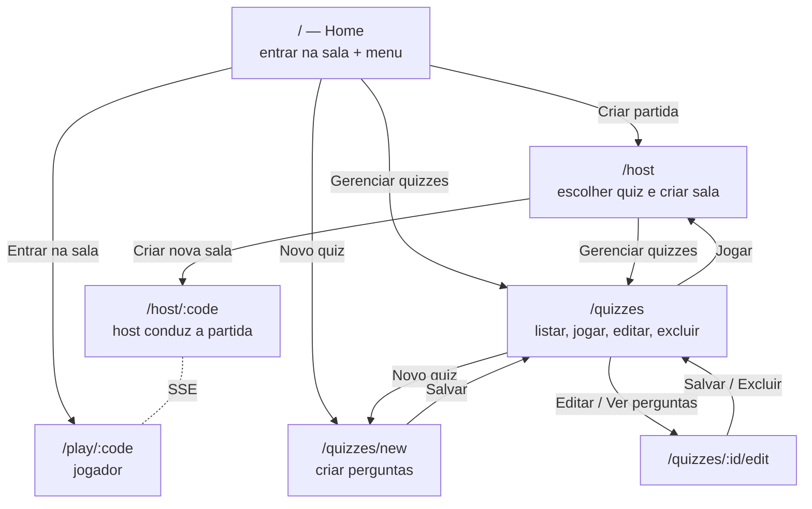
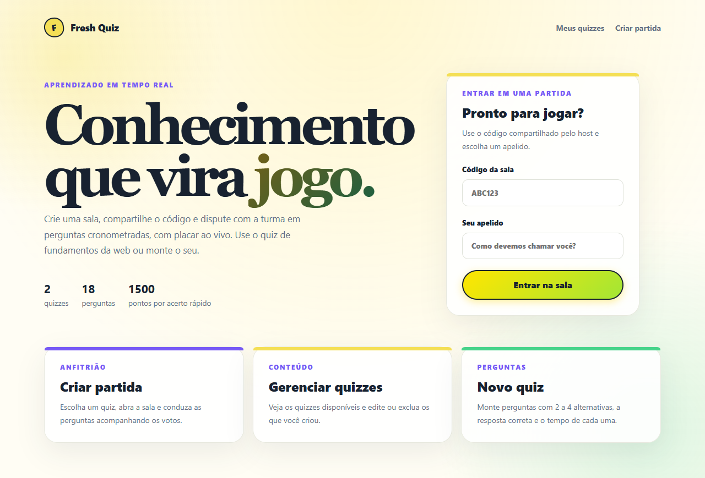
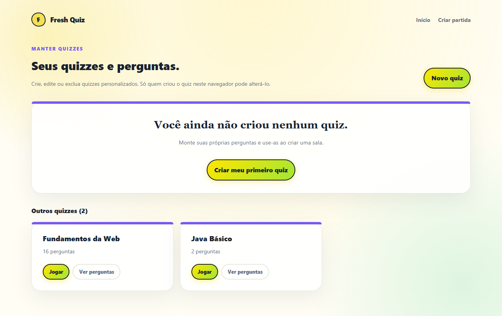
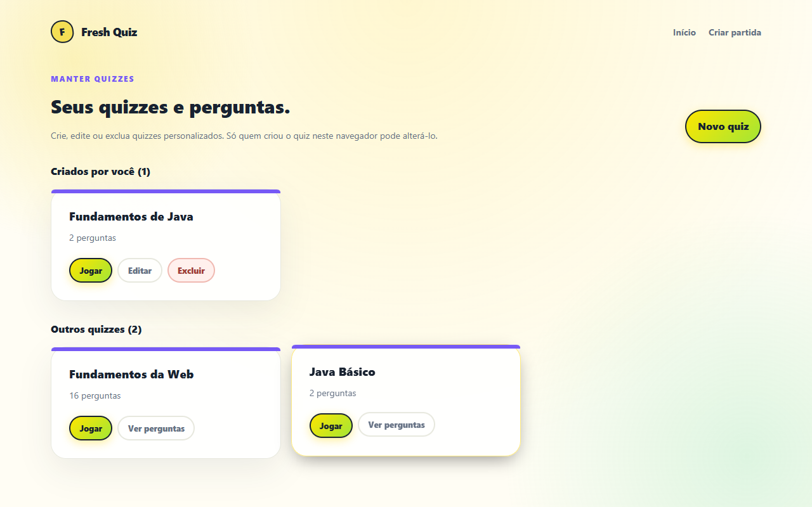
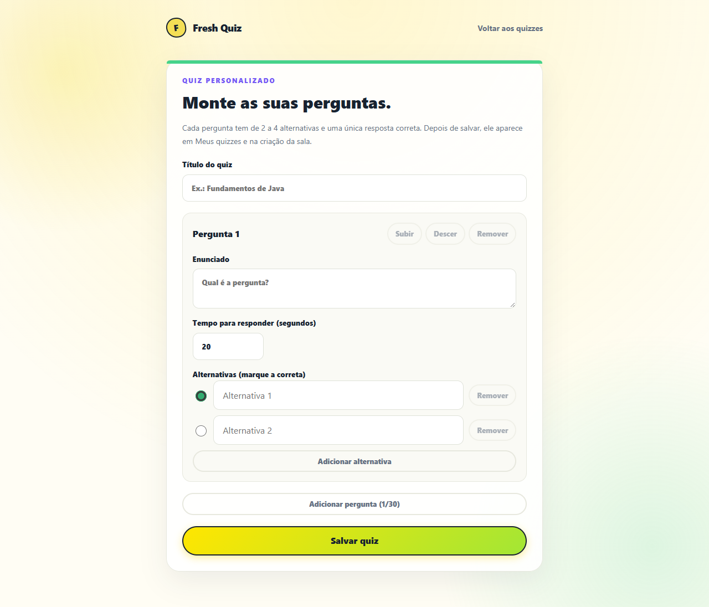
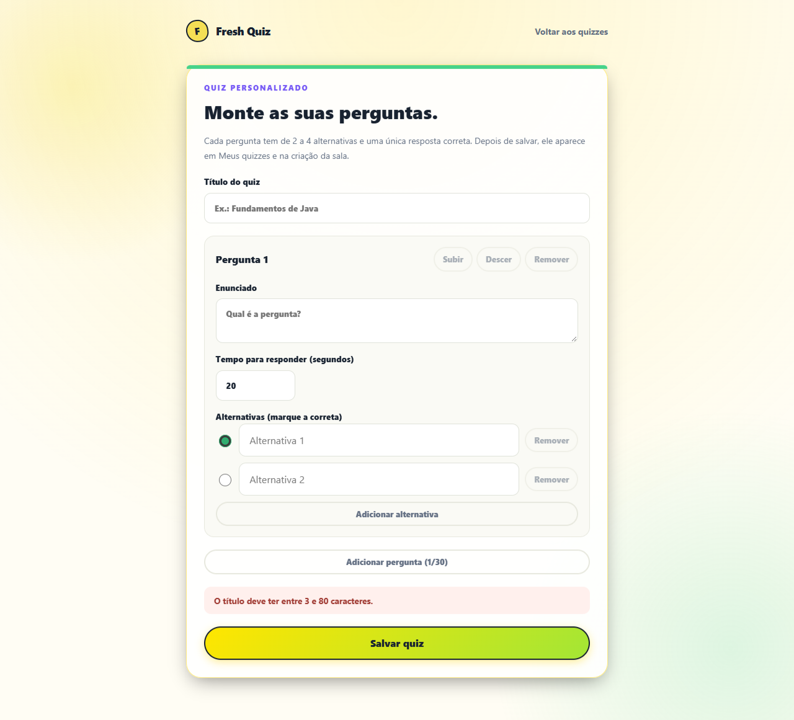
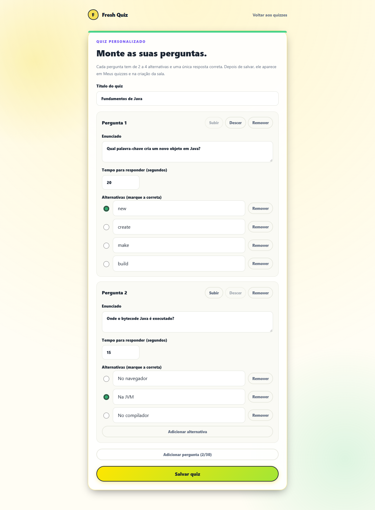
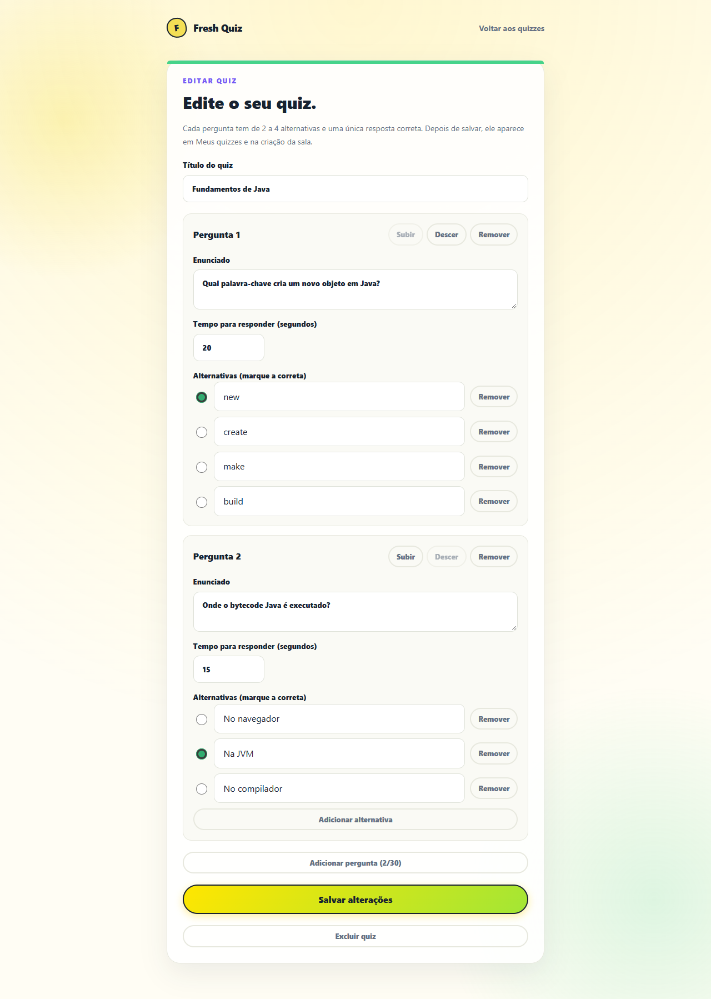
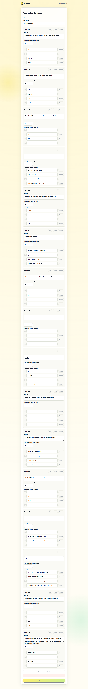
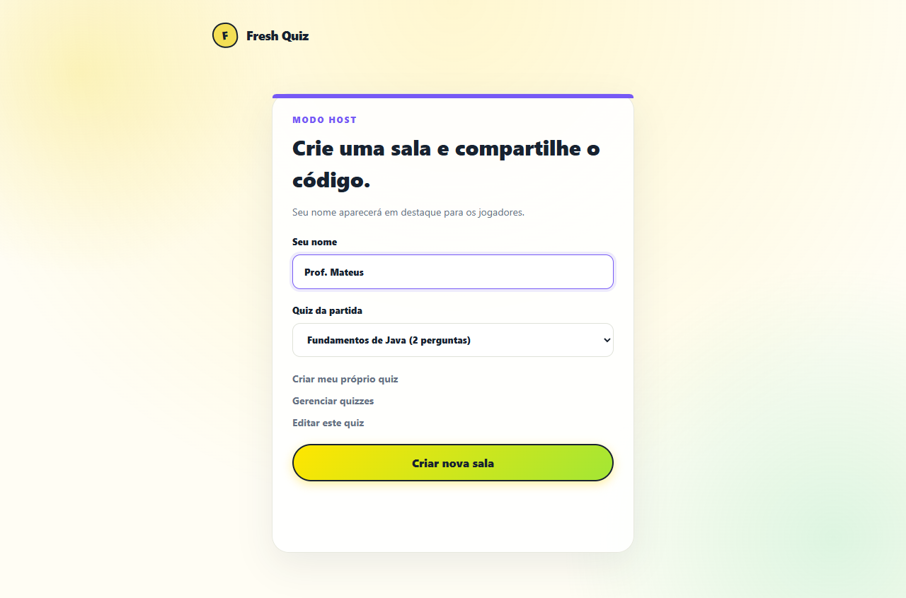

# Front-end Angular

[← Voltar ao README](../../README.md)

Angular 22 com componentes standalone, signals e o novo control flow (`@if`,
`@for`). Não há biblioteca de estado nem de UI. O CSS global fica em
`frontend/src/styles.css`.

## Arquitetura

```
frontend/src/app/
├── app.routes.ts        rotas (uma página por rota)
├── core/                modelos, GameApi (HTTP), GameStateStore (SSE → signals),
│                        quiz-draft (rascunho/validação do CRUD), shuffle, votes
├── pages/               HomePage, HostLandingPage, HostGamePage, PlayerGamePage,
│                        QuizListPage, QuizBuilderPage
├── game/                HostGame, PlayerGame, Ranking
└── ui/                  Brand, Countdown, Podium, LoadingState, DevtoolsGuide
```

- **`GameApi`** (`providedIn: 'root'`) transforma cada chamada HTTP em `Promise`
  e converte erros em `ApiError` com a mensagem do backend.
- **`quiz-draft.ts`** reúne funções puras e imutáveis sobre o rascunho do quiz
  (`addQuestion`, `removeChoice`, `setCorrectChoice`, `validateQuiz`,
  `toQuizPayload`…). Por isso a tela de criação só faz `draft.update(fn)`. Os
  testes ficam em `quiz-draft.spec.ts`.

## Signals store (`GameStateStore`)

A store não é global. `HostGamePage` e `PlayerGamePage` a declaram em
`providers`, e os componentes filhos (`HostGame`, `PlayerGame`, `Ranking`)
recebem a mesma instância. Ao sair da página, o `ngOnDestroy` fecha o
`EventSource`.

| Signal       | Conteúdo |
| ------------ | -------- |
| `state`      | Último `GameState` recebido (`null` até o primeiro evento). |
| `connection` | `connecting`, `online` ou `offline`, exibido no ranking. |
| `error`      | Mensagem quando a sessão é inválida ou a sala não existe. |

Fluxo: `connect(code)` abre `EventSource('/api/games/:code/events')`, e cada
evento `state` faz `state.set(...)`. Quando a conexão volta, a store busca
`GET /state` para não perder mudanças. Os componentes derivam o resto com
`computed` (votos, tempo restante, pódio), e o template reage sozinho.

## Fluxo das telas



| Rota | Página | Caso de uso |
| ---- | ------ | ----------- |
| `/` | `HomePage`: tela principal, com formulário de entrada e atalhos | Entrar na Sala |
| `/host` | `HostLandingPage`: nome do host e escolha do quiz | Gerenciar partida |
| `/host/:code` | `HostGamePage`: lobby, perguntas, votos ao vivo e pódio | Gerenciar partida |
| `/play/:code` | `PlayerGamePage`: responder e ver o ranking | Responder Pergunta / Sair da Sala |
| `/quizzes` | `QuizListPage`: lista dos quizzes (os seus e os demais) | Manter Quizzes |
| `/quizzes/new` | `QuizBuilderPage`: cria título, perguntas, alternativas e tempo | Manter Quizzes |
| `/quizzes/:id/edit` | `QuizBuilderPage`: edita ou exclui (somente leitura se não for o dono) | Manter Quizzes |

## Protótipos

Capturas do sistema rodando. O PDF com todas as telas está em
[`prototipos/prototipos-fresh-quiz.pdf`](prototipos/prototipos-fresh-quiz.pdf).

### Tela principal (Home): Entrar na Sala



### Manter Quizzes: listagem

| Sem quizzes próprios | Com quiz criado |
| -------------------- | --------------- |
|  |  |

### Manter Quizzes: criação de perguntas

| Formulário vazio | Validação | Preenchido |
| ---------------- | --------- | ---------- |
|  |  |  |

### Manter Quizzes: edição e visualização

| Edição (dono) | Somente leitura |
| ------------- | --------------- |
|  |  |

### Gerenciar partida: criar sala com o quiz escolhido


